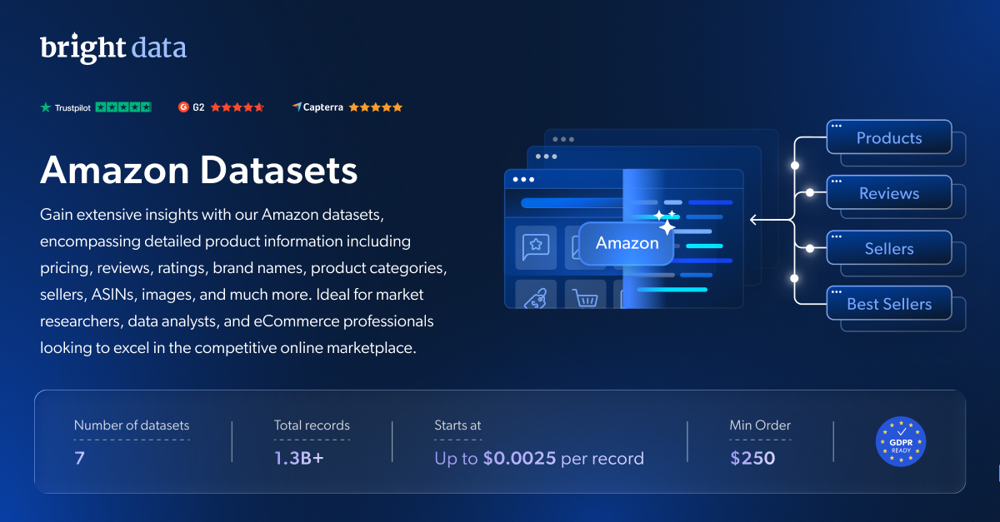

# Amazon-dataset-samples

<h2>包含 1001 款 Amazon 商品的样本数据集</h2>

<a href="https://www.bright.cn/products/datasets/amazon">
   
</a>

包含 1000 多款商品的 Amazon 数据集样本。该数据集使用 <b>Bright Data API</b> 提取。

<h2>此免费数据集包含的数据点：</h2>

* ```title```：商品标题
* ```brand```：商品品牌
* ```description```：商品简介
* ```currency```：商品使用的货币
* ```availability```：商品库存状态
* ```reviews_count```：评论数量
* ```categories```：商品类别
* ```asin```：每款商品的唯一标识符
* ```buybox_seller```：购物车中的卖家
* ```root_bs_rank```：商品在常规类别中的畅销排名
* ```images_count```：图片数量
* ```url```：直接链接到商品的 URL
* ```video_count```：视频数量
* ```image_url```：直接链接到商品图片的 URL
* ```rating```：商品评分
* ```date_first_available```：商品首次上架日期
* ```manufacturer```：商品制造商
* ```plus_content```：是否存在其他内容
* ```final_price```：商品最终价格
* ```buybox_prices```：商品价格详情

以及更多数据。

这是“Amazon 商品（公开数据）”数据集的样本子集，该完整数据集包含超过 <b>269,400,000 款商品</b>。

可用的数据集文件格式：<b>JSON、NDJSON、JSON Lines、CSV 或 Parquet。文件还可选择压缩为 .gz 格式</b>。

数据集交付方式：<b>电子邮件、API 下载、Webhook、Amazon S3、Google Cloud Storage、Google Cloud Pub/Sub、Microsoft Azure、Snowflake、SFTP</b>。

更新频率：<b>单次、每日、每周、每月、每季度或自定义</b>。

可在已提取的数据点基础上增加数据扩充服务：<b>根据请求提供。</b>

<b>[获取完整的 Amazon 商品数据集](https://www.bright.cn/products/datasets/amazon)</b>。

<h2>其他可用的 Amazon 数据集：</h2>

* Amazon.es - 商品
* Amazon.de - 商品
* Amazon.co.uk - 商品
* Amazon.it - 商品
* Amazon.fr - 商品
* Amazon.in - 商品
* Amazon 商品搜索
* Amazon 畅销商品
* Amazon 评论
* Amazon 卖家信息
* Amazon 全球商品数据集

<a href="https://www.bright.cn/products/datasets/amazon">
   
</a>

<h2>Amazon 数据集有哪些使用场景？</h2>

<h3>1. 优化库存与定价策略</h3>

发现客户正在搜索和购买的畅销商品。全面优化库存、定价、供应链和营销策略，实现最高效率。

<h3>2. 获得竞争优势</h3>

Amazon 的顶级卖家拥有成功秘诀。研究他们的商品、评论和促销活动，以激发新的商业创意，或邀请他们入驻你的商城。

<h3>3. 了解消费者情绪与品牌趋势</h3>

监测不同国家/地区的热门类别和品牌，发现消费者偏好及商品受欢迎程度的变化。

<h2>为学术研究人员和 NGO 免费提供网页爬虫工具与数据集</h2>

Bright Initiative 为顶尖高校院系和研究人员，以及致力于推动各类环境和社会公益事业的 NGO 与 NPO，提供 Bright Data 的 <b>[网页爬虫工具 API](https://www.bright.cn/products/web-scraper)</b> 和 <b>[即用型数据集](https://www.bright.cn/products/datasets)</b>。你可以在<b>[此处](https://brightinitiative.com)</b>提交申请。
